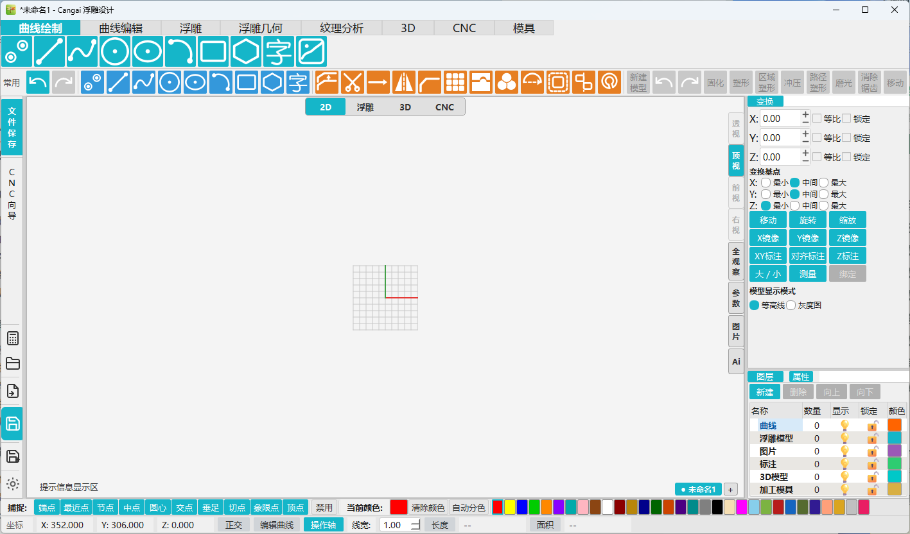

<p align="center">
  
</p>

<h1 align="center">Cangai · 蜻蜓浮雕设计</h1>

<p align="center">
  面向 <b>浮雕设计</b> 的一体化 CAD 桌面软件：从二维矢量绘图，到三维浮雕建模，再到 CNC 雕刻刀路输出，全流程一站式完成。
</p>

<p align="center">
  
  
  
  
  
</p>

---

## 简介

Cangai（蜻蜓）是一款面向 **浮雕雕刻与数控加工** 场景的开源 CAD 软件。它将传统精雕软件的复杂工作流重新解构，以「绘图 → 浮雕 → 刀路 → 输出」为主线，让设计师和雕刻师在同一个窗口中完成从创意草图到可上机加工的全部工作。

软件采用 **数据层（core）与界面层（ui）分离** 的分层架构、**命令模式** 的统一操作入口，并提供基于 Qt-Advanced-Docking-System 的停靠式布局与 ModernGL 硬件加速三维视口，兼顾专业性与流畅体验。同时开放 **插件系统、稳定 API 与 AI 自动化接入面**，使其既是一款成品工具，也是一个可扩展的开放平台。

## 核心能力

Cangai 覆盖浮雕雕刻的完整链路：

```
2D 矢量绘图 ──▶ 3D 浮雕建模 ──▶ CNC 刀路生成 ──▶ G 代码 / NC 输出
     │               │                │
     ├─ 曲线 / 捕捉   ├─ 区域浮雕 / 扫掠  ├─ 轮廓 / 钻孔 / 3D 加工
     ├─ 编辑 / 变换   ├─ 布尔 / 实体     └─ 碰撞检测 / 仿真
     └─ 文字 / 图片   └─ 图像转模型
```

## 功能特性

### 二维矢量绘图

- 基础图元：点、直线、圆、圆弧、椭圆、矩形、多边形
- 自由曲线与 **NURBS 曲线**（Catmull-Rom / B-Spline / NURBS 数学内核）
- **文字**：TTF/OTF 字体字形解析与单线提取，支持多字体排版
- **螺纹**参数化生成
- **图片矢量化**（VTracer 引擎）与图片导入

### 智能捕捉与编辑

- 完整捕捉体系：端点、中点、圆心、交点、垂足、切点、四分点
- 捕捉类型工具条开关与右键快捷单选
- 编辑命令：倒角、修剪、阵列、偏移、组合 / 解散、连接、镜像、延伸、闭合、轮廓、对齐、桥接、尺寸标注对齐
- 变换面板：平移、旋转、缩放、测量
- 图层面板、属性面板、对象管理

### 三维实体与浮雕建模

- 实体布尔（并、差、交）、倒角、圆角、墙线
- 挤出、推拉等直接建模工具
- **ModernGL 硬件加速 3D 视口**，实时预览

### 浮雕雕刻（核心）

- 新建模型与高度场编辑
- **区域浮雕**：选区高度映射
- **印章**：浮雕盖章式应用
- **扫掠加料 / 添加材料 / 高度移动**
- **平滑 / 扫掠平滑**：表面精修
- **区域变换 / 阵列 / 对称 / 变形**
- **区域斜面 / 旋转斜面**：坡度雕刻
- **水平校准**、**重建浮雕**、**去抖动**、**模型缩放**
- **图像转模型**：将灰度图 / 位图直接生成浮雕高度场

### CNC 刀路与输出

- 机床设置、毛坯定义、刀具管理、轮廓加工、碰撞检查、**体素仿真**
- 刀路类型：轮廓铣、钻孔、扩孔、铣螺纹、单线切割、摆槽、区域加工、**3D 粗加工**、**3D 精修**
- **后处理体系**：内置 Mach3 三轴（精雕 JD50，默认）、GRBL、UCCNC 后置处理器
- 模态化优化输出（G 代码 / 坐标 / 进给去冗余）、程序头尾宏、换刀宏、自定义后置文件（`.py`）导入
- 生成 G 代码预览、一键导出 **NC 文件**（ASCII + CRLF，兼容主流控制器）

### 导入 / 导出

| 格式 | 导入 | 导出 |
| --- | :-: | :-: |
| DXF | 支持 | 支持 |
| STL | 支持 | 支持 |
| STEP | — | 支持 |
| SVG | 支持 | 支持 |

### 开放平台：插件与 API

- **插件系统**：目录 / 单文件插件，`plugin.json` 清单，`register / unregister` 生命周期
- **稳定 API**：`core.api.CangaiAPI`（`API_VERSION = 1`），文档、对象、几何、命令、事件、UI 服务全套接口
- **事件总线**：`document.added / removed / changed`、`selectionChanged`、`command.started / finished`、`app.ready` 等
- **AI 自动化**：`commandManifest()` 作为 AI 工具清单、`runScript()` 脚本执行、无头（headless）批处理
- **界面服务**：动作注册、工具按钮、命令注册、状态栏与历史反馈、跨线程安全调度

### 界面与国际化

- Qt-Advanced-Docking-System 停靠式布局，面板可自由停靠 / 浮动 / 分组
- 可停靠画布、文件、变换、图层、属性等面板
- **中英双语**国际化（`i18n`）

## 界面预览

主界面：顶部分类菜单（曲线绘制 / 曲线编辑 / 浮雕 / 浮雕几何 / 纹理分析 / 3D / CNC / 模具），左侧快捷栏，中央网格画布，右侧变换 / 图层 / 属性面板，底部捕捉与状态栏，构成完整的雕刻工作流。

<p align="center">
  
</p>

> 更多界面（浮雕建模、CNC 刀路、3D 视口）截图陆续补充。

## 快速开始

### 环境要求

- Windows 10 / 11
- Python **3.12.x**（依赖链中 moderngl / glcontext 在 3.13+ 无稳定 wheel，勿升级基线）
- 建议 8 GB 内存以上（大型浮雕 / 布尔运算较吃内存）

### 从源码运行

```bash
# 1. 创建虚拟环境（必须使用 Python 3.12）
python -m venv .venv

# 2. 安装依赖
.venv\Scripts\pip install -r requirements.txt

# 3. 启动
run.bat
```

> 图片矢量化依赖 `vtracer`（PyPI 无官方 wheel，需本地编译），未安装时该功能会提示，其余功能不受影响。

### 回归测试

```bash
run.bat test
```

### 打包发布

```bash
# 生成便携版
build_portable.bat

# 生成安装包
build_installer.bat
```

## 使用流程示例

1. **绘图**：使用 2D 工具绘制轮廓曲线，或直接导入 DXF / SVG / 图片矢量化。
2. **浮雕**：选中区域执行「区域浮雕」，或用「图像转模型」导入位图生成高度场。
3. **建模**：在 3D 视口中进行布尔、平滑、阵列等浮雕精修。
4. **刀路**：在 CNC 面板中设置机床、毛坯与刀具，选择刀路类型并生成路径。
5. **输出**：选择后置处理器生成 G 代码，预览并导出 NC 文件上机雕刻。

## 文档

| 文档 | 说明 |
| --- | --- |
| `docs/PROJECT_SPEC.md` | 项目规范：架构、代码规范、测试与 Git 工作流 |
| `docs/API与插件架构.md` | 开放平台：API / 插件 / AI 自动化接入 |
| `docs/CNC路径输出后处理体系设计.md` | CNC 后处理体系设计 |

## 技术架构

```
┌────────────────────────────────────────────────────┐
│  ui/（界面层）                                     │
│  windows · widgets · view_2d · view_3d             │
│  commands · styles(主题) · i18n(国际化)            │
└──────────────┬─────────────────────────────────────┘
               │ 仅允许 ui → core 依赖
┌──────────────▼─────────────────────────────────────┐
│  core/（领域层）                                    │
│  document · vector · snap · grid · spline_utils    │
│  relief · cnc · text · export · api · plugin       │
└────────────────────────────────────────────────────┘
```

- **命令模式**：所有用户操作收敛为命令（`executeCommand → 交互 → 完成`），撤销 / 历史 / 重放统一承载。
- **数据与视图分离**：`core/vector` 为纯数据模型，2D 画布由 `item_factory` + `scene_bridge` 同步，逻辑不侵入 `QGraphicsItem`。
- **信号集中接线**：跨控件通信统一通过 Qt Signal，集中在 `mainWindow` 装配，控件间不互相引用。
- **开放门面**：第三方代码只允许通过 `core.api.CangaiAPI` 交互，内部重构不破坏插件与 AI 接入。

## 项目结构

```
cangai_relief/
├── main.py                  # 唯一入口：QApplication + MainWindow
├── requirements.txt         # 版本锁定依赖（Python 3.12）
├── run.bat                  # 启动 / 测试入口
├── Cangai.spec              # PyInstaller 打包配置
├── build_portable.bat       # 便携版打包
├── build_installer.bat      # 安装包打包
├── core/                    # 领域层（禁止依赖 ui/）
│   ├── document.py          # Document / Layer 模型
│   ├── vector/              # 几何对象（点线圆弧曲线 NURBS 实体 浮雕模型…）
│   ├── snap/                # 捕捉求解
│   ├── relief/              # 浮雕建模（区域浮雕 / 扫掠 / 图像转模型…）
│   ├── cnc/                 # CNC 刀路 + 后处理（posts/）
│   ├── text/                # 文字排版与字体
│   ├── export/              # DXF / STL / STEP / SVG 导入导出
│   ├── api.py               # CangaiAPI 开放门面（API_VERSION = 1）
│   └── plugin_manager.py    # 插件加载与生命周期
├── ui/                      # 界面层
│   ├── windows/             # mainWindow（QtAds 停靠布局装配点）
│   ├── view_2d/             # 2D 画布 MVC
│   ├── view_3d/             # ModernGL 3D 视口
│   ├── commands/            # 命令系统与具体命令
│   ├── widgets/             # 工具栏、面板、对话框
│   └── styles/              # QSS 主题与颜色常量
├── plugins/                 # 内置插件
├── i18n/                    # 中英双语国际化
├── icons/                   # SVG 图标与 Cangai.ico
├── deps/                    # vendored 第三方源码（PySide6-QtAds、pymillcam）
└── docs/                    # 项目文档
```

## 插件开发示例

插件通过 `register(api)` 注册动作、命令与工具按钮，并可订阅事件总线：

```python
# plugins/my_tools/main.py
def register(api):
    def my_action(context):
        doc = api.activeDocument()
        doc.beginEdit()
        oid = api.addPolyline([(0, 0), (100, 0), (50, 80)])
        doc.endEdit()
        api.notify(f"已生成对象 {oid}")

    api.registerAction(
        "myplugin.action1", my_action,
        title="画一个三角形",
        meta={"group": "我的插件", "description": "示例动作"},
    )

    api.registerToolButton(
        key="myplugin.action1", label="三角形",
        group="我的插件", pluginId="myplugin",
    )

    unsubscribe = api.events.subscribe(
        "document.added", lambda oid: print("新增对象", oid),
    )

def unregister(api):
    # 可选：清理手动订阅等资源
    ...
```

## AI 自动化接入

Cangai 的开放 API 天然是 AI 的操作面，推荐分层接入：

- **工具调用型（Agent + function calling）**：通过 `api.commandManifest()` 获取全部可执行能力作为工具清单，Agent 调用 `runAction` / `executeCommand`，并订阅事件形成执行闭环。
- **脚本生成型（LLM 生成代码）**：让 LLM 生成 Python 代码，经 `api.runScript(code)` 执行（注入 `api`），适合批量绘图与参数化生成。
- **无头批处理**：门面不依赖 GUI，在无界面环境下同样可驱动 `core` 文档（适合脚本化与自动化测试）。

```python
from core.api import CangaiAPI

api = CangaiAPI()
api.addPolyline([(0, 0), (100, 0), (50, 80)])
doc = api.activeDocument()
doc.save("out.cai")
```

## 路线图

> 以下为规划方向，随开发进度更新。

- [ ] 打包发布稳定版本与安装包
- [ ] 2D 对象在 3D 视口的完整材质化渲染
- [ ] 更丰富的浮雕笔刷与雕刻工具
- [ ] 更多 CNC 后置处理器与控制器支持
- [ ] 插件市场 / 示例插件库
- [ ] 更多导入格式（如 BMP 深度图、OBJ）

## 贡献

欢迎提交 Issue 与 Pull Request。提交前请确保：

- 通过静态检查：`.venv\Scripts\python -m pyflakes core ui main.py`
- 通过回归测试：`run.bat test`
- 遵循 `docs/PROJECT_SPEC.md` 中的代码规范（Conventional Commits、类型注解、分层依赖约束）

## 许可证

本项目采用 **双许可证（Dual License）** 发布，可任选其一：

- **MIT License** —— [LICENSE-MIT](LICENSE-MIT)
- **Apache License 2.0** —— [LICENSE-APACHE](LICENSE-APACHE)

详细说明见 [LICENSE](LICENSE)。除另行明确声明外，你向本项目提交的任何有意纳入的贡献，均按上述双许可证条款授权，不附加额外条款或条件。
